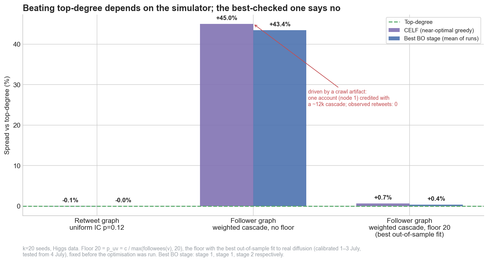
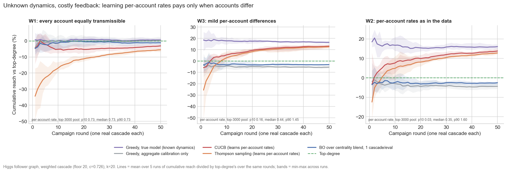
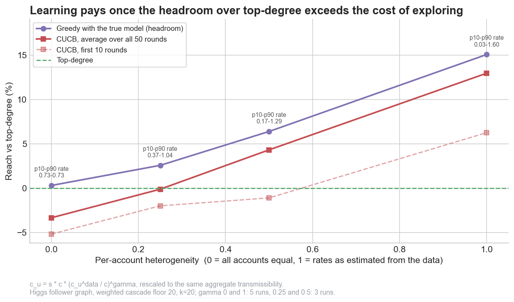

# Engineering Virality with Bayesian Optimization

**Primary study:** [Influence Maximization using Bayesian Optimization on the Higgs Graph](https://app.chinmayarora.com/blog/influence-maximization-bayesian-optimization-higgs/)

Code behind the figures in
[Engineering Virality with Bayesian Optimization](https://app.chinmayarora.com/blog/virality-bo/)

> **Correction (Nov 2026).** Earlier versions of this code built the graph
> with edges pointing from retweeter to retweeted, so every cascade ran *against*
> the direction information actually flows. "Top-degree" meant "retweeted the
> most", not "was retweeted the most". The bug is fixed and every number below
> comes from a full rerun. **The earlier headline (BO beats top-degree by
> +2.5% / +4.5%) does not survive the fix.** The published posts were corrected on 5 Nov
> 2026. See [Changes in the rerun](#changes-in-the-rerun).

Influence maximization under the Independent Cascade (IC) model on the SNAP
Higgs **retweet** network (largest weakly-connected component: 223,833 nodes /
308,596 edges, oriented retweeted → retweeter). The question: can Bayesian
Optimization select a seed set of k=20 nodes that spreads further than a
top-degree heuristic?

All numbers: [`RESULTS.md`](RESULTS.md) (generated from the pipeline outputs, not
typed by hand) and `results/summary.json`.

## The four-stage experiment

Every stage uses the **same objective** (k=20, IC p=0.12, 80 simulations per
evaluation) and the **same top-degree baseline** (global top-20 by number of
retweeters, scored at 4,000 simulations: **8,012.5**). BO and random search get
the **same number of evaluations** in the same space. Each run's best point is
re-evaluated with 400 fresh simulations, and the table reports mean ± sd across runs.

| Stage | Script | Search space | BO (mean ± sd over runs) | vs top-degree | Random search, same budget | Best BO set ∩ top-degree |
|---|---|---|---|---|---|---|
| 1. Rule-tuning | `01_rule_tuning_bo.py` | 3-D blend of degree / PageRank / k-core | 8,009 ± 15 (5 runs) | −0.04% | 7,998 ± 13 | 20/20 |
| 2. Rules + redundancy | `02_stronger_variant.py` | 4-D: exponents, redundancy penalty, hop | 8,007 ± 9 (5 runs) | −0.06% | 8,002 ± 22 | 20/20 |
| 3. Free-node, naive | `03_freenode_naive.py` | 120-D spectral-embedding anchors | 737 ± 431 (4 runs) | −91% | 748 ± 418 | 1/20 |
| 4. Free-node, constrained | `04_freenode_constrained.py` | 13-D (12 latent + diversity weight) over top-400 pool | 7,919 ± 41 (5 runs) | −1.2% | 7,492 ± 204 | 19/20 |

Controls:
- **CELF** (lazy greedy on 200 fixed live-edge snapshots, top-3000 pool) picks
  **the same 20 seeds as top-degree** (8,003.5 fresh; difference is noise).
- **Decoder-only** (stage 4 decoder with no BO bias, diversity weight swept on a
  grid) also returns exactly the top-degree set.

## What the rerun supports

1. **On this graph and IC setting, top-degree is effectively optimal for k=20.**
   CELF, the standard near-optimal greedy, picks the same set. Cascades are
   shallow (retweeters are rarely retweeted themselves), and the top-20 accounts'
   direct audiences overlap only ~13%. That leaves very little redundancy for
   diversity-seeking strategies to recover.
2. **BO never beats top-degree here.** In stages 1–2 it rediscovers the top-degree
   set exactly. In stage 4 it lands one seed away and is 1.2% worse.
3. **Search-space design still decides whether BO can *match* the baseline.**
   In low-dimensional, degree-anchored spaces (1, 2, 4) BO gets within ~1%. In
   the naive 120-D space (3), BO and random search both collapse to ~9% of the
   baseline.
4. **BO beats random search only where the space is hard.** In stage 4, BO
   averages 7,919 ± 41 versus 7,492 ± 204 for random search, with lower variance
   and every BO run above every random-search run. In stages 1–2 both methods sit
   on the same plateau. In stage 3 neither makes progress.

What it does **not** support: any claim that BO, diversity or redundancy
penalties improve on top-degree for this graph.

## Follower-graph validation and rerun (Nov 2026)

The study above simulates diffusion over the retweet graph, whose edges are
retweets that already happened. [`validation/`](validation/README.md) checks the
simulator against the real Higgs activity log and the follower (exposure) graph,
then reruns all four stages on the follower graph.

- **Substrate.** 59% of retweets travel along follow edges. On the follower graph the
  top-20 accounts' audiences overlap 44–65%, against 13% on the retweet graph.
- **Calibration and held-out test.** A weighted cascade (p_uv = c / max(followees(v), F))
  is calibrated on 1–3 July and tested from 4 July. Out of sample it reproduces cascade
  depth (0.053 vs 0.056 observed) but under-predicts spread about 4.7×, because
  transmissibility tripled at the announcement.
- **A crawl artifact that optimisers exploit.** Without the floor (F = 1), 33k users who
  appear to follow a single account make node 1 look like a 12k-node spreader. It was
  never retweeted. CELF and BO then "beat" top-degree by +45% and +43%, almost entirely
  by adding node 1. The floor F = 20 was chosen by out-of-sample fit before rerunning.
- **Per-account check.** No model variant ranks candidate accounts better than raw
  follower count (Spearman ≈ 0.5; 8 of the top 20 in the observed top 20, same as
  top-degree).

Rerun on the follower graph with F = 20 ([`RESULTS_follower_wc_F20.md`](RESULTS_follower_wc_F20.md)):

| | vs top-degree |
|---|---|
| CELF | +0.67% |
| Stage 1, rule-tuning BO | −0.12% (random search −0.69%) |
| Stage 2, rules + redundancy BO | +0.36% (random search +0.34%) |
| Stage 3, naive free-node BO | −92% |
| Stage 4, constrained free-node BO | −0.32% (0/5 runs above the decoder-only control) |

**Conclusion: on the better-validated simulator, top-degree is still within 1% of the
best seeding found, and BO adds nothing over random search in the rule spaces.** Heavy
audience overlap costs little here because per-exposure activation probabilities are
small, so a follower being reached twice is rare.



## Stage 6: when does a sample-efficient method win? (Nov 2026)

Stages 1–5 sit in one corner of the problem: the spread model is **known** and
scoring a seed set is **cheap** (a simulation). That corner favours greedy, which has a
near-optimality guarantee for submodular spread (Kempe, Kleinberg & Tardos 2003), and it
is why nothing beat top-degree. Stage 6 ([`pipeline/06_unknown_dynamics.py`](pipeline/06_unknown_dynamics.py))
moves to the opposite corner. Each account's transmissibility is **unknown**, and every
evaluation is **one real campaign** (one cascade), run over 50 rounds. This is the
online influence-maximization setting: combinatorial bandits with probabilistically
triggered arms (Chen, Wang, Yuan & Wang, JMLR 2016, which corrects the IM claim in their
ICML 2013 paper) and semi-bandit feedback (Wen et al., NeurIPS 2017). Here it runs with
per-account parameter sharing so it scales to the 14.9M-edge follower graph.

**Worlds.** All use p_uv = c_u / max(followees(v), 20) on the follower graph.
- **W1:** every c_u = 0.726, the calibrated value.
- **W2:** per-account c_u estimated from each account's real retweet yield that week,
  shrunk toward 0.726 with a gamma-Poisson prior fitted by marginal likelihood. The
  estimate covers only accounts that posted; the rest keep 0.726.
- **W3:** W2's evidence with 10× stronger shrinkage.
- **Dose-response worlds:** heterogeneity scaled directly, c_u ∝ (c_u^W2)^γ, renormalised
  to the same aggregate.

W2 is a plausible scenario shaped by the data, not measured truth. A realised retweet
yield mixes transmissibility with luck.

**Policies.** Each chooses 20 seeds per round.
- **Greedy with the true model:** known dynamics, the reference.
- **Top-degree.**
- **Greedy with aggregate calibration only.**
- **CUCB and Thompson sampling:** both learn per-account rates from edge-level feedback,
  starting from the aggregate calibration.
- **GP-EI BO over the stage-1 centrality blend:** one cascade per evaluation.

The fast greedy oracle is checked against snapshot CELF on the true model and lands
within 0.7% in every world. Five runs per policy; all numbers are in
[`RESULTS_unknown_dynamics.md`](RESULTS_unknown_dynamics.md).

| Reach vs top-degree, same world | W1 equal accounts | W2 rates as in data |
|---|---|---|
| Headroom: greedy with the true model | +0.3% | +15.1% |
| Greedy with aggregate calibration only | +0.2% | −5.1% |
| CUCB, first 10 rounds / all 50 / final seed set | −5.2% / −3.3% / +0.7% | +6.3% / +12.9% / +15.5% |
| Thompson, first 10 rounds / all 50 / final seed set | −16.8% / −5.8% / −0.7% | +3.5% / +11.9% / +14.9% |
| BO over centrality blend, all 50 rounds | −1.4% | −3.2% |
| CUCB passes top-degree in cumulative reach | never | round 2 |



**Dose-response.** Adaptive learning beats top-degree over a 50-round campaign only once
the headroom exceeds about 3%. In W3, γ = 0.25 is roughly break-even. Exploration costs
a few percent up front, and the gain scales with how much accounts really differ.

| γ (0 = W1, 1 = W2) | Headroom | CUCB, all 50 rounds |
|---|---|---|
| 0 | +0.3% | −3.3% |
| 0.25 | +2.6% | −0.1% |
| 0.5 | +6.4% | +4.3% |
| 1 | +15.1% | +12.9% |



### The method map so far

| Corner | What wins on Higgs | Evidence |
|---|---|---|
| Dynamics known, feedback cheap | Greedy ≈ top-degree; BO adds nothing | Stages 1–5, both substrates |
| Dynamics unknown, accounts alike | Top-degree; learning only costs reach | Stage 6, W1 |
| Dynamics unknown, accounts differ, one shot | Top-degree. Greedy on an aggregate-only model is *worse* (−4 to −5%) | Stage 6, round 1 |
| Dynamics unknown, accounts differ, multi-round | Bandit (CUCB) wins from round 2–4 and nears the true-model oracle by round ~40 | Stage 6, W2/W3 |
| BO choosing seeds, any corner | Never wins. The centrality blend cannot express which accounts are strong. | Stages 1–4, 6 |
| Spread driven by content (topic, timing) | **Untested.** Higgs has one topic. | Needs a multi-item dataset (e.g. Digg 2009, Twitter15/16) |

Two readings:
- **Sample efficiency matters when the unknown is account-level and campaigns repeat.**
  That's where a learner earns its exploration cost.
- **BO picking seeds is the wrong use of BO.** If BO has a role, it is the content-driven
  corner (message, timing, budget split), with a bandit or greedy choosing the seeds.

**Caveats specific to stage 6.**
- Learners see edge-level feedback (who was exposed, who retweeted whom). That's realistic
  for attributed retweets, but treating follows as exposures is an approximation.
- The worlds are **stationary**. The held-out test shows transmissibility tripling at the
  4 July announcement; stale estimates would hurt learners in a real campaign, and that
  isn't modelled.
- Fifty campaigns of 20 seeded accounts each is a stylised budget.
- W2's headroom depends on estimating per-account rates from one week of realised outcomes.

## Methods

- **Objective:** mean activated count over Monte Carlo IC simulations (noisy black box).
- **Optimizer:** GP regression (Matérn 2.5 + white noise) with Expected Improvement.
- **Matched curves:** `curve[i]` = best value after `i+1` objective evaluations,
  for BO (initial design included) and random search alike.
- **Run-to-run variability:** each run's best re-evaluated fresh. Reported as
  mean ± sd and as "runs above top-degree".
- **Set-level tests:** Welch t-tests over 30×150-simulation estimates. These
  compare two *fixed* seed sets and support "this set beats or loses to top-degree",
  not "the method beats top-degree".
- **CELF:** sample-average approximation over fixed live-edge snapshots, which keeps
  the objective submodular so lazy evaluation is valid. The chosen set is scored with
  independent simulations.

## Reproducing

```bash
python3 -m venv .venv && .venv/bin/pip install -r ../requirements.txt
# get the data - see data/README.md - and place the retweet edgelist in pipeline/
cd pipeline
python 00_build_graph.py            # -> rt_graph.pkl (edges reversed to diffusion direction)
python 01_rule_tuning_bo.py         # -> baselines.pkl, bo_results.pkl
python 02_stronger_variant.py       # -> bo_strong_results.pkl
python 03_freenode_naive.py         # -> bo_freenode_results.pkl
python 04_freenode_constrained.py   # -> bo_constrained_results.pkl
python 05_summary.py                # -> ../RESULTS.md, ../results/summary.json
# follower-graph validation and rerun (needs higgs-social_network + higgs-activity_time)
python 00b_build_follower_graph.py  # -> follower_graph.npz
python ../validation/calibrate_and_holdout.py && python ../validation/account_ranking_check.py
GRAPH=follower python 01_rule_tuning_bo.py   # ... through 05_summary.py; outputs carry a _follower_wc_F20 suffix
python 06_unknown_dynamics.py       # stage 6 (~25 min) -> unknown_dynamics.pkl
GAMMAS=0.25,0.5 POLICIES=oracle,top-degree,CUCB N_RUNS=3 python 06_unknown_dynamics.py   # dose-response (~7 min)
cd ../charts && for f in 0[1-4]*.py; do python $f; done   # retweet-graph figures -> charts/figures/*.png
GRAPH=follower python 05_substrate_comparison.py && GRAPH=follower python 06_unknown_dynamics_charts.py   # -> RESULTS_unknown_dynamics.md
```

The full pipeline takes about 3 minutes on a laptop. `QUICK=1` runs a smoke test with
tiny budgets, and `05_summary.py` refuses to summarise those outputs. `IC_P=…`
reruns everything at another activation probability. Shared settings live in
`pipeline/common.py`. Loading a graph pickle built with the old edge direction
fails with an error.

## Changes in the rerun

Fixes made after a code audit (Nov 2026):

| Issue | Fix |
|---|---|
| Edges added retweeter → retweeted, so cascades ran backwards | `00_build_graph.py` adds retweeted → retweeter. The graph pickle carries a direction tag that is checked on load. PageRank is computed on the endorsement graph. |
| BO curve point *i* covered *i*+5/6/12 evaluations, random-search point *i* covered *i*+1 | Both curves are indexed by total evaluations (`common.run_bo` / `run_random`) |
| Stage 1 used IC p=0.05 while stages 2–4 used 0.12. "179" was mis-attributed. Charts hardcoded `[179, 91, 183.1]` | One objective for all stages. Charts read only from pickles and assert that all stages agree. |
| Stage 4's top-degree came from a different pool than stage 3's | One shared global top-degree baseline (`baselines.pkl`) |
| Stage 4 had no random-search control and was described as "12-D" (actually 13-D) | Added a 13-D random-search control with the same budget, a decoder-only control, and 5 runs re-evaluated individually |
| p-values presented as evidence that BO beats top-degree | Relabelled as set-level. Run-level mean ± sd reported. |
| CELF used 20/40-sim noisy marginal gains, which breaks lazy greedy | Snapshot (SAA) CELF, scored with independent simulations |
| Stage 4 saved no pickle, stage 1 had a dead `vals` line, and charts hardcoded values and `/home/claude` paths | Fixed |

## Honest limitations

- The original results use the retweet graph with uniform p=0.12. The follower graph
  with a calibrated weighted cascade was tested (above) and leaves the conclusion
  unchanged. A larger k, and seeding interventions in the real world, were not tested.
- The follower-graph simulator under-predicts spread out of sample (about 4.7×) and
  ranks accounts no better than follower count, so all strategy comparisons remain
  simulation results.
- Stage 6's per-account worlds are scenarios shaped by one week of data and are stationary. The content-driven corner of the method map is untested.
- The stage-3 collapse is partly a budget artifact (120-D, 60 noisy evaluations).
- Run counts are small (4–5 per stage), so the run-level sds are rough.
